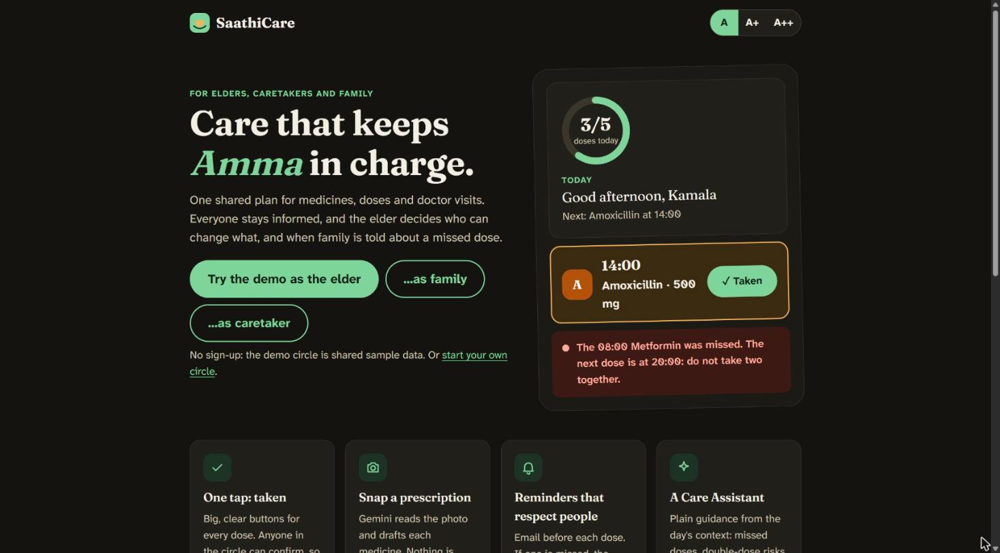
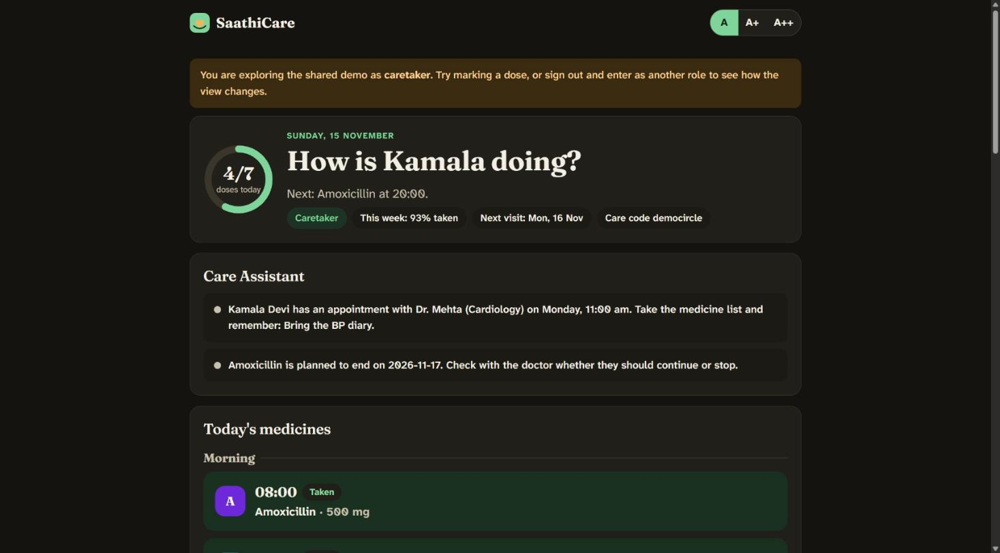
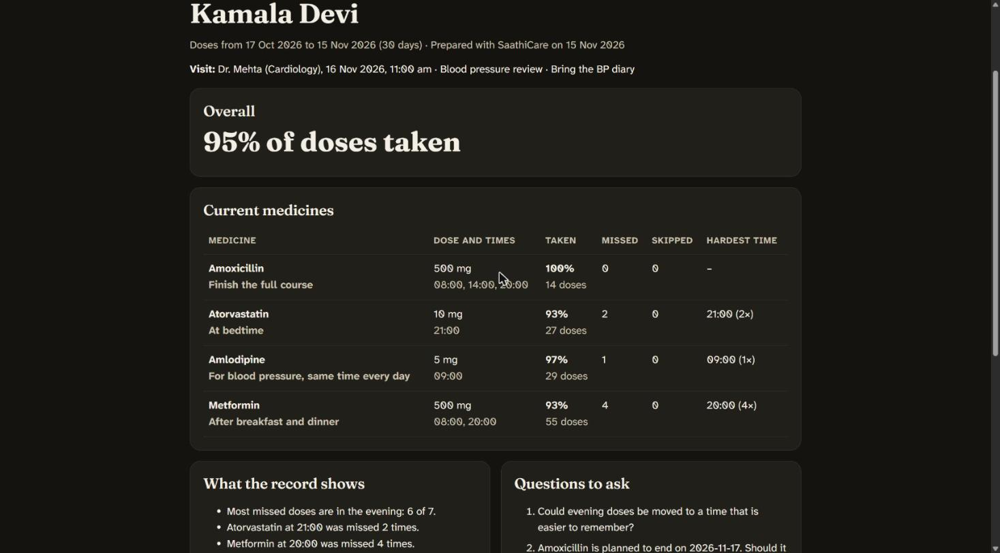

# SaathiCare

**One shared care plan for an elder, their caretakers and their family, with the elder in charge.**

| 🌐 Live app                                                        | 🧭 Guided tour (2 min)                                                       | 🧪 Quality                                                                                                    |
| ------------------------------------------------------------------ | ---------------------------------------------------------------------------- | ------------------------------------------------------------------------------------------------------------- |
| **[saathicare-six.vercel.app](https://saathicare-six.vercel.app)** | **[saathicare-six.vercel.app/tour](https://saathicare-six.vercel.app/tour)** | 136 automated tests · [CI on every push](https://github.com/ManveerAnand/saathicare/actions/workflows/ci.yml) |

[Watch the 3-minute live walkthrough on YouTube](https://youtu.be/C2gg__Ma_Rk).

> **No sign-up needed.** On the home page, press **"Try the demo as the elder"** (or as family or
> caretaker). You land in the shared care circle of Kamala Devi, 72, with a month of real-looking
> history. The [guided tour](https://saathicare-six.vercel.app/tour) walks through every feature
> step by step.



## Try it in 2 minutes

1. **As the elder:** open the [home page](https://saathicare-six.vercel.app) and press **Try the
   demo as the elder**. The ring shows today's doses; the **Care Assistant** warns that a dose was
   missed and the next one is soon (_do not take two together_). Press **✓ Taken** and watch the
   day update. At the bottom, **Your choices** is where the elder decides who may edit and when
   family is told about a missed dose.
2. **As family:** press **Sign out**, then **…as family**. The page now asks _"How is Kamala
   doing?"_, and there are no edit forms, because the elder has not allowed family to edit. Family
   can still confirm a dose.
3. **As a caretaker:** sign in as caretaker. Under **Medicines**, try **Add from a prescription
   photo** (Gemini drafts each medicine; nothing is saved until you confirm) or **What is this
   for?** (a plain-language explanation for an elderly reader).
4. **Before a doctor's visit:** in **Upcoming visits**, press **Prepare for the doctor** for a
   printable 30-day summary with missed-dose patterns and questions to ask.
5. **Accessibility:** use **A+ / A++** at the top right; the whole app scales. Try it on a phone.

If other visitors have changed the shared demo, the **Reset demo data** button on the dashboard
restores it.

| The day at a glance                                                                                                           | Ready for the doctor                                                                                                                                   |
| ----------------------------------------------------------------------------------------------------------------------------- | ------------------------------------------------------------------------------------------------------------------------------------------------------ |
|  |  |

## Why it is different

SaathiCare (_saathi_ means "companion" in Hindi) keeps medicines, doses and doctor visits in one
place. Everyone signs in to the same care circle with their own passcode, and email reminders make
sure doses and appointments are not forgotten. It goes beyond a reminder app in four ways:

1. **The elder stays in charge.** The elder decides who may change the care plan, and when they
   miss a dose, they are reminded first. Family and caretakers are told only after a delay the
   elder chooses.
2. **Adding medicines takes one photo.** Gemini reads a prescription or medicine label and drafts
   the schedule. Nothing is saved until a person checks and confirms each medicine.
3. **Everyone understands the medicines.** A "What is this for?" button gives a short,
   plain-language explanation, written for an elderly reader.
4. **The doctor sees the real picture.** One tap turns 30 days of doses into a printable visit
   summary: what is taken, how reliably, when the routine breaks down ("Metformin at 20:00 missed
   4 times"), and questions to ask. Elders often cannot recall this in a short appointment.

Built for the Catalyst Solo AI Hackathon (PromptWars x Catalyst, by Makers Need More).

## Chosen vertical

**Healthcare: Elderly Care & Medication Management.** The persona is an elder who manages
several medicines and doctor visits, supported by a caretaker and by family who may live
elsewhere. Every decision in the app is made around that elder.

## Approach and logic

The app is a **smart, dynamic assistant**: it makes decisions from the user's context (who is
viewing, the time in the elder's time zone, what was taken, the elder's own preferences) rather
than only storing a list. The decisions are plain, tested functions in `src/lib/domain`:

| Decision                    | Context it uses                                                               | Logic                                                                                                                                                                                                                                                                                                                                                       | File             |
| --------------------------- | ----------------------------------------------------------------------------- | ----------------------------------------------------------------------------------------------------------------------------------------------------------------------------------------------------------------------------------------------------------------------------------------------------------------------------------------------------------- | ---------------- |
| Status of each dose         | Time now in the elder's time zone, dose logs                                  | Due from 30 min before; missed 60 min after with no log; otherwise later, taken or skipped                                                                                                                                                                                                                                                                  | `schedule.ts`    |
| Who gets an email, and when | Dose status, the elder's escalation delay, appointment time                   | The elder is reminded 30 min before and again when a dose is missed; caretakers and family only after the elder's delay; everyone 24 h before an appointment; never the same email twice                                                                                                                                                                    | `reminders.ts`   |
| Care Assistant guidance     | Today's doses, 7-day adherence, appointments, course end dates, viewer's role | Missed dose with the next one under 4 h away: warn against doubling up. Missed otherwise: prompt to log it or ask the doctor. Adherence under 80% across at least 3 doses: suggest a pill box or a check-in. Appointment within 48 h: what to bring. Course ending within 3 days: check with the doctor. Speaks to the elder as "you" and to others by name | `assistant.ts`   |
| Who may change the plan     | Role, the elder's choices                                                     | The elder always can; caretakers and family only if the elder allows; only the elder changes these rights                                                                                                                                                                                                                                                   | `permissions.ts` |
| Adherence                   | Logs over 7 days                                                              | Taken out of decided doses (taken, missed, skipped); upcoming doses are not counted against anyone                                                                                                                                                                                                                                                          | `schedule.ts`    |

AI (Gemini) is used where judgment on messy input helps: reading prescription photos and
explaining medicines. Safety-critical rules (timing, escalation, permissions) are deterministic,
so they are predictable and testable.

## Assumptions

- One care circle per elder, shared through a care code and three role passcodes. Separate
  user accounts were deliberately left out, so elders never need an email login.
- Dose times are fixed daily times in the elder's time zone. "As needed" medicines and weekly
  schedules are not modelled yet.
- A dose counts as missed 60 minutes after its time if nobody has logged it.
- Email is the reminder channel, as the problem asks; SMS or WhatsApp could be added behind the
  same `Mailer` interface.
- The app gives no medical advice. The Care Assistant and Gemini explanations always point to
  the doctor for any change.
- The reminder job runs every 15 minutes, so an email can arrive up to 15 minutes after its
  ideal time.

## Problem statement, mapped to the code

| The problem asks for                                              | How SaathiCare does it                                                                                                      | Where                                                             |
| ----------------------------------------------------------------- | --------------------------------------------------------------------------------------------------------------------------- | ----------------------------------------------------------------- |
| A shared ecosystem for elders, caretakers and family              | One care circle per elder, with three roles: elder, caretaker, family                                                       | `src/lib/domain/types.ts`                                         |
| Secure, passcode-based access                                     | A separate passcode per role, hashed with scrypt; signed, httpOnly, SameSite=strict session cookie; rate-limited sign-in    | `src/lib/auth/`                                                   |
| View, add, edit and manage medication schedules                   | Medicines with dose, instructions, daily times, and start and end dates; soft delete keeps the history                      | `src/app/actions/carePlan.ts`, `src/components/forms/`            |
| Track adherence                                                   | One-tap "Taken" or "Skip"; 7-day adherence with a daily trend                                                               | `src/lib/domain/schedule.ts`                                      |
| Monitor upcoming doctor appointments                              | Appointments with doctor, reason, place and notes                                                                           | `src/components/circle/AppointmentsCard.tsx`                      |
| Email reminders for upcoming doses, missed doses and appointments | A reminder job every 15 minutes, idempotent, so each email is sent once                                                     | `src/lib/domain/reminders.ts`, `src/lib/reminderJob.ts`           |
| Smarter and more accessible                                       | Gemini prescription reading, plain-language explanations, a large-text elder view                                           | `src/lib/ai/gemini.ts`, `src/app/globals.css`                     |
| Collaborative and reliable                                        | Anyone in the circle can confirm a dose; reminders escalate to others                                                       | `src/lib/domain/reminders.ts`                                     |
| Smarter: decisions from context                                   | A Care Assistant gives role-aware guidance (missed doses, double-dose risk, low adherence, upcoming visits, courses ending) | `src/lib/domain/assistant.ts`                                     |
| Helps at the doctor's visit                                       | A printable 30-day summary: adherence per medicine, the hardest dose times, missed-dose patterns and questions to ask       | `src/lib/domain/visitSummary.ts`, `src/app/circle/visit/page.tsx` |
| The elder at the centre of their own decisions                    | Only the elder controls editing rights and the escalation delay; the elder is always told first                             | `src/lib/domain/permissions.ts`                                   |

## How it works

```
Browser (server-rendered pages, small client forms)
   │  Server Actions: every input checked with zod, every change checked against the role
   ▼
Next.js on Vercel ──► Firestore (profiles, medications, dose logs, appointments)
   │              └─► Gemini (prescription photo → draft medicines; explanations, cached)
   ▼
/api/cron/reminders  ◄── GitHub Actions every 15 min (Bearer CRON_SECRET)
   └─► Gmail SMTP: elder first, then caretakers and family after the elder's chosen delay
```

The rules (scheduling, adherence, reminders, permissions) are plain TypeScript functions in
`src/lib/domain`, with no framework or database code, so they are easy to test and reuse.
Storage sits behind a `Repo` interface with a Firestore version and an in-memory version.

## Project structure

```
src/app/                Pages and routes (landing, setup, tour, care circle, visit summary, reminder cron)
src/app/actions/        Server Actions by topic: auth, demo, carePlan, ai (session.ts holds the shared checks)
src/components/circle/  The care circle dashboard, one small server component per card
src/components/forms/   Client forms, one file per form (sign-in, setup, medicine, appointment, scan, choices)
src/lib/domain/         Pure rules: schedules, adherence, reminders, assistant, permissions, visit summary
src/lib/auth/           Passcode hashing, signed session tokens, sign-in rate limit
src/lib/repo/           Storage behind one interface: Firestore and in-memory versions
src/lib/ai/             Gemini calls (prescription reading, medicine explanations)
src/lib/env.ts          Validated server configuration
src/lib/log.ts          Scoped logs that omit private error details
src/lib/auth/cron.ts    Constant-time check for the reminder endpoint's bearer token
src/lib/ai/parse.ts     Schema validation of Gemini prescription drafts
src/lib/ai/image.ts     Image signature checks for prescription uploads
src/lib/presentation.ts Display helpers shared by the pages (labels, greeting, date formats)
```

## Google services

- **Gemini API:** reads prescription photos into structured drafts (JSON output, validated with
  zod before anyone sees it), and writes short medicine explanations.
- **Cloud Firestore:** stores every care circle. Security rules deny all browser access; only the
  server reads and writes it.

## Security

- Passcodes are never stored, only scrypt hashes with a random salt, checked in constant time.
- Sessions are HMAC-signed, expire after 12 hours, and are httpOnly, Secure and SameSite=strict.
- Every Server Action re-checks the session and the elder's permissions on the server.
- All input is validated with zod; photos are limited to JPEG, PNG or WebP under 4 MB.
- Sign-in is limited to 5 attempts per 15 minutes per client and care code.
- Security headers: Content-Security-Policy, HSTS, X-Frame-Options, nosniff and Referrer-Policy.
- Gemini output is treated as untrusted: schema-checked, and only shown as a draft to confirm.
- Secrets live in environment variables only (see `.env.example`); the reminder endpoint needs
  a bearer secret, compared in constant time.

## Accessibility

Designed for older eyes and hands: an 18px base font (larger in the elder's view), high-contrast
colours with a dark mode, 48 to 64px touch targets, labels on every field, a skip link, visible
focus rings, `aria-live` status messages, a text alternative for the trend chart, and support for
reduced motion. Everything works with the keyboard alone.

## Efficiency and scalability

- Pages render on the server, so little JavaScript is sent to the browser.
- Each page load makes three parallel, bounded Firestore queries (active medicines, the last
  7 days of logs, upcoming appointments).
- Gemini explanations are generated once per medicine and cached; a changed name or dose
  clears the cache.
- Reminders are idempotent: each one has a stable key, recorded once sent, so the job can run
  often or be retried safely.
- The app is stateless and scales out horizontally. Each care circle is its own document
  subtree in Firestore.

## Run it locally

```bash
npm install
npm run dev
```

With no environment variables, it runs with in-memory storage and prints emails to the console.
To use real services, copy `.env.example` to `.env.local` and fill it in.

## Tests

```bash
npm test             # 136 automated tests across 19 files
```

### Development

```bash
npm run format        # format tracked source and documentation
npm run check         # check formatting, lint, check types and run tests
npm run test:coverage # measure coverage for the instrumented library code
```

[CI](.github/workflows/ci.yml) checks formatting, lint, types and coverage thresholds, then runs a production build on every push.

## Deploy

1. Deploy to Vercel and set the variables from `.env.example`.
2. In GitHub, add the repository variable `APP_URL` (the deployed URL) and the secret
   `CRON_SECRET`, so `.github/workflows/reminders.yml` runs the reminders every 15 minutes.

## How it was built

Built with AI assistance (Claude Code). The prompts went from the problem statement, to a score
map of the judging criteria, to small testable modules. The domain rules came first, with tests,
then storage, then the UI.

---

SaathiCare is a reminder and coordination tool. It does not give medical advice.
